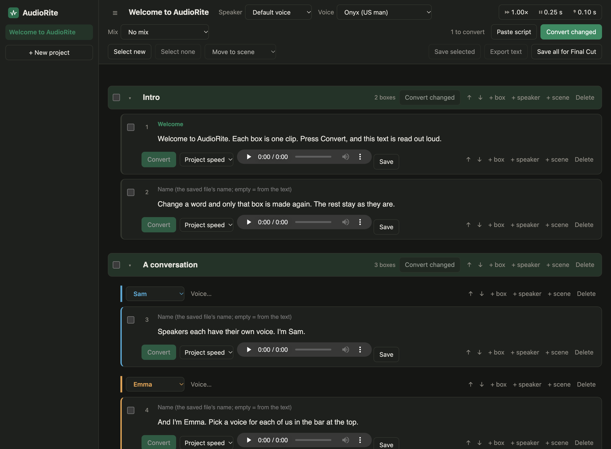

# AudioRite

Voiceover for how-to videos, made on your own Mac. Write the script, press Convert, and get one clean audio
clip per paragraph to drop into your video editor. No account, no subscription, nothing sent to the cloud.



I make screen-recorded tutorials for my apps. Filming and editing are quick; recording my own voice is not:
the accent, the stumbles, the repeats. AudioRite reads the script for me, with voices that don't sound robotic,
and I keep doing the timing myself in Final Cut.

It was built on a **2020 Intel MacBook Pro with no GPU**, and it is fast enough there: Kokoro makes speech at
about the speed it is spoken, Piper much faster. It should also run on Apple Silicon Macs, but I have no such
Mac to test it on.

## What it does

- **One box, one clip.** Change a word and only that box is made again; everything else stays as it was.
- **40 English voices**: 28 from [Kokoro](https://huggingface.co/hexgrad/Kokoro-82M) (the natural-sounding
  ones) and 12 from [Piper](https://github.com/OHF-Voice/piper1-gpl) (the fast ones).
- **Speed** per project and per box. **Pause length** after sentences and commas, and a **mix** of two voices
  (Kokoro). Rhythm and tone (Piper).
- **Speakers**: give each person in a conversation their own voice.
- **Scenes**: group boxes, fold them, move them, convert one scene at a time.
- **Paste a whole script**: each paragraph becomes a box, `Sam: Hello` starts Sam's turn, `## Title` starts a scene.
- **Save** one clip, the ticked ones, or all of them numbered in order for Final Cut (or any editor). WAV files.
- **Word list**: teach it how to say a product name once (`words.txt`).

## What you need

- A Mac. Made and tested on macOS 26 on Intel.
- Python 3.10 to 3.13. The one that comes with macOS is too old;
  [python.org](https://www.python.org/downloads/macos/) has 3.12.
- Google Chrome (the Save dialogs use a Chrome feature).
- About 1.1 GB of disk: 300 MB of Python packages and 800 MB of voices.

## Install

```bash
git clone https://github.com/bulwafa/Audiorite.git AudioRite
```

```bash
cd AudioRite && ./setup.sh
```

The setup script makes two Python environments inside the folder, installs the packages and downloads the
voices. Nothing is installed outside the folder. To remove AudioRite, delete the folder.

Keep the folder's path short, for example `~/AudioRite`. Piper stops working when the path is very long.

## Use

Double-click **AudioRite.app** in the folder. It starts a small local server and opens the page in its own
Chrome window. (If macOS refuses to open it, right-click the app and choose Open.) For a copy in
/Applications, run `./setup.sh app`.

A sample project is there the first time. Type in a box, press **Convert**, listen. The first clip takes a
little longer because the voice has to load.

Your projects are in `projects/` and the clips in `Temp/clips/`. Closing the window leaves the server running;
it only listens on your own Mac (`localhost:8765`).

### The word list

`words.txt` in the folder says how a word should be read. One per line:

```
Vivosun = Vee-vo-sun
```

Changing it changes how those boxes are read, so they need converting again.

## Voices and their licences

AudioRite doesn't include any voices. The setup script downloads them from their own homes:

| Voice | From | Licence |
| --- | --- | --- |
| Kokoro, all 28 English voices | [hexgrad/Kokoro-82M](https://huggingface.co/hexgrad/Kokoro-82M), files from [kokoro-onnx](https://github.com/thewh1teagle/kokoro-onnx) | Apache 2.0 |
| Piper Mike | [rhasspy/piper-voices](https://huggingface.co/rhasspy/piper-voices) | data: CC0 |
| Piper Bryce | same | data: public domain |
| Piper p17 … p216 (LibriTTS) | same | data: CC BY 4.0 |
| Piper northern English male | same | data: CC BY-SA 4.0 |
| Piper Ryan | same | data: CC BY-NC-SA 4.0, **not for commercial use** |

The Piper licences are those of the recordings each voice was trained on, as its model card states them.
Check them yourself before using a voice in paid work.

## Licence

AudioRite is free software under the [GNU GPL, version 3 or later](LICENSE), because it uses Piper, which is
GPL. It comes with no warranty. I built it for my own videos and share it as it is.
